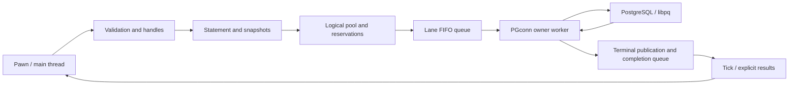

# Architecture and implementation contract

Original architecture review: October 13, 2026. API/documentation contract rechecked against
`master` at `3a5215d` on October 17, 2026; see the [native reference](native-reference.md).
Candidate version 0.1.0-rc.2 retains this architecture. These are internal design reviews;
the completed independent Astra review is recorded in [the audit report](independent-audit.md).

## References examined

- [SA-MP-MySQL](https://github.com/pBlueG/SA-MP-MySQL/tree/9524fcc9088004948770ddd6e05a6074581d3095),
  BSD-3-Clause: CConnection, CHandle, CDispatcher, CCallback, CResult, and a_mysql.inc.in.
  The design retains queues and tick-driven completion dispatch. It does not retain separate
  threaded/parallel/unthreaded paths, an active cache, ORM, escaping as a security strategy,
  or implicit extra connections. Its round-robin pool does not preserve order across sessions,
  and its dispatcher invokes functions while holding the mutex. This component extracts
  completed work before invoking Pawn.
- [omp-MySQL](https://github.com/Mac-Andreas/omp-MySQL/tree/f7a6e4d7cd4e619fc3f70de5b6c5429ecd91059b),
  MIT: MySQLComponent, QueryQueue, Statement, Connection, natives, and documentation.
  The design retains worker ownership of each session and deferred preparation. It omits
  the synchronous API, ActiveRecord, hashing, global cache, and callback lookup in other
  scripts. A callback belongs to a specific generation of the originating script.
- Official open.mp SDK: commit 473b732b2de159773b2e2908fd11aa99f07db284.
  IComponent, CoreEventHandler, PawnEventHandler, and IPawnScript support native registration
  and callbacks without the SA-MP plugin bridge or an additional pawn-natives dependency.
- [libpq 17](https://www.postgresql.org/docs/17/libpq.html): service connections, the extended
  query protocol, nonblocking submission, single-row mode, and transaction state.
  Minimum client version: 17. The server must support the SQL used by the gamemode.

This is an original implementation; no reference-plugin code is included.
Dependencies retain their original licenses.

## Modules and invariants

| Module                           | Responsibility                                                                                          |
| -------------------------------- | ------------------------------------------------------------------------------------------------------- |
| component.cpp / component.hpp    | IComponent entry point, SDK events, VM generations, and callbacks.                                      |
| natives.cpp / omp_postgresql.inc | Pawn contract, memory validation, and native registration.                                              |
| engine.cpp / engine.hpp          | Handles, owners, logical pools, transaction reservations, acceptance, and retained results.             |
| session.cpp / session.hpp        | Exclusive PGconn, FIFO worker and queue, nonblocking libpq, preparation, reconnection, and publication. |
| statement.cpp / statement.hpp    | Staging, snapshots, stable types, and confined SQL file loading.                                        |
| parameters.cpp / parameters.hpp  | Typed parameter encoding, UTF-8, and arrays.                                                            |
| config.cpp / config.hpp          | Configuration and resource limits.                                                                      |
| types.hpp                        | Shared error/status values, operations/batches, and immutable results.                                  |

The open.mp thread owns handle registries, statement staging, and callback metadata.
Each lane has a worker that exclusively owns its PGconn. Queued jobs own their SQL and
parameter snapshots. Results are published before an atomic terminal transition and remain
immutable afterward. Positive identifiers are never recycled during the component's lifetime.

Pools contain lanes numbered from zero. The default lane is always zero; there is no hidden
round-robin distribution. Each lane is FIFO. Keeping an entity on one lane preserves ordering.
There is no ordering across lanes, so the gamemode must use SQL versions or locks when
concurrent lanes share records. A transaction reserves a lane until COMMIT/ROLLBACK reaches
terminal completion. Other lanes remain available.

`pg_connect` returns a logical handle immediately. Connected means every lane is ready;
`pg_connection_ready` reports how many are connected. Queries are rejected until the entire
pool is ready. Reconnection invalidates session preparation. Affected jobs fail without
automatic replay. A write sent without a definitive response is classified as uncertain.

## Uniform execution contract

`pg_prepare` accepts SQL, an explicit parameter count, and prepared/direct mode.
The component does not infer placeholders with a regular expression; PostgreSQL validates
SQL. Binding indices start at 1. `pg_add` requires all parameters, captures a snapshot,
and clears temporary bindings. Rebinding before `pg_add` replaces only that value.
NULL is distinct from a missing parameter. The first parameter set fixes the statement's
OIDs; later sets must match. `pg_execute` accepts only nonempty batches and returns a job
identifier. Acceptance consumes the batch; queue rejection restores it. Closing the
statement does not affect accepted jobs.

A job/batch retains results for the attempted operation prefix, with zero-based indices,
and stops at the first error. An interrupted operation need not have a retained result.
Earlier statements outside a transaction may already be confirmed. Within a
transaction, they remain provisional. COMMIT after a required failure is rejected and rolled
back. Affected rows and completed statements are separate counts.

The fixed callbacks `OnPgConnection(connection,state)` and `OnPgComplete(job,context)` run
only in the originating VM. Suppressing a callback does not make execution synchronous;
status remains available for polling. Context is an application token. The gamemode must
check the player's session generation before using it; the component does not interpret
arbitrary player identifiers.

Heterogeneous batches flatten the added parameter sets of several statements into one job.
Operation count, attempted results, confirmed operations, returned rows, and affected rows
are separate measures. Per-operation statuses preserve partial completion. A streaming job
instead publishes bounded blocks through `OnPgRows` and retains final metadata without
accumulating all rows. Its main-thread consumer never waits for the producer.

Jobs/results remain alive until `pg_job_close`. There is no active cache or implicit release
at callback return. Limits account for retained results, staging, parameters, connections,
and jobs. Local rejection returns 0/false, with details in `pg_last_error`, without consuming
the batch.

## Transactions and failures

BEGIN returns a job whose handle also identifies the transaction. Wait for success before
submitting statements. COMMIT and ROLLBACK are separate jobs. Reserved lanes reject external
work. Transactions have a total deadline and statements have a query timeout.
Cancellation observed after dispatch closes the session; its outcome may be uncertain and
is not equivalent to a confirmed ROLLBACK. Reconnection never restores a transaction.

Explicit BEGIN options can override session defaults. Savepoint commands are independent
asynchronous jobs on the reserved lane; only confirmed rollback-to clears the failure state.
Stream delivery can fail after SQL confirmation, in which case the job fails while the SQL
item remains confirmed. A new execution must never infer that such a write should be replayed.

## SQL files and security

`pg_prepare_file` creates a logical statement. Reading and validation run in the worker
before SQL submission. The root is `scriptfiles/sql`; paths must be relative `.sql` paths.
Canonicalization checks confinement, and reading enforces size and UTF-8 limits.
Only one SQL command is supported: the extended protocol rejects multiple commands.
The operator manages the directory, which must not be writable by players. The component
does not protect against an administrator changing symbolic links concurrently.

`pg_prepare_file(..., section)` uses a section-name field in the statement/job/operation path.
Workers build a bounded lexical index of each named file, validate all structural sections,
then capture selected SQL before dispatch. Homogeneous snapshots share one selection;
heterogeneous named inputs are preflighted and share an index per relative filename string
within that job. No file index survives worker execution and no global cache is introduced.
PGconn ownership, FIFO, parameters, transactions, results and VM cleanup are unchanged.
See [named SQL sections](sql-sections.md) for error, edit, memory and lexical contracts.

Connections use libpq service profiles without passwords in Pawn. Configure TLS through
`sslmode=verify-full` and `sslrootcert` in the profile. TLS is not imposed on Unix sockets.
The component does not log SQL, parameters, or server messages, which may contain sensitive
data. Explicit diagnostics are accessible only to the owning VM.

## Pipeline evaluation

Grouping extended queries without Sync changes implicit transaction boundaries and propagates
PGRES_PIPELINE_ABORTED. The initial engine uses sequential prepared execution and bulk SQL
through UNNEST. Pipeline integration is not advertised as implemented. A future optimization
requires Sync per independent execution, result correlation, bounded transport windows,
and lost-confirmation tests before it is enabled.

## Pre-RC API consolidation

The [cleanup audit](prestable-cleanup.md) records the historical 68-native consolidation
before `pg_log_config` restored the inventory to 69; see the [current reference](native-reference.md).
[PR #16's audit](api-modernization.md) is also historical. `SqlSourceKind` replaces the ambiguous file boolean in Statement,
Operation and Job; inline/file/section selection is explicit through snapshot transfer.
Unified file preparation uses one checked creation path and the existing lexical parser.

Each job optionally owns one CallbackDescriptor with a public name and bounded scalar/string
arguments. A shared native parser validates/copies Pawn varargs before enqueue. One internal
job factory installs common ownership/notification metadata. Workers never inspect that
metadata. The central tick dispatcher consumes it, resolves the owning generation's public,
pushes copied values and restores the existing complete VM frame. No post-submit registry,
new dispatch queue, global public cache or new native variants are introduced. Full behavior
and lifecycle limits are in [custom callbacks](callbacks.md).

## Pre-stable cleanup

Use `pg_prepare_file(connection, filename, parameters, prepared, section)` for named SQL.
The removed `pg_prepare_section` requires source migration and AMX recompilation; other
leading argument/default positions remain supported. See [migration](prestable-cleanup.md)
and [internal diagnostics](debugging.md).
